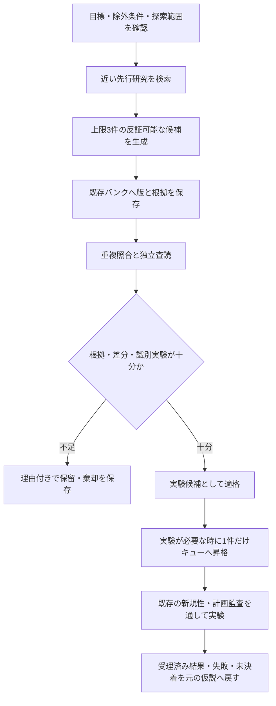

# 新規性のある研究仮説を蓄積するエージェント workflow の調査と改良案

作成日：2026-10-24。調査期間：2026-10-23〜24、文献の対象日は2026-10-23まで。

**提案は、既存の仮説バンクを拡張し、候補の保存と実験キューへの投入を分離することです。**
12系統の一次資料を調べました。生成・選別・研究記憶を扱う11系統と、後段の実験を支える1系統を比較しています。関連版と論文・コードは重複して数えていません。

「世界で未発見」は、検索やエージェントの合意だけでは保証できません。保存するのは、**調べた範囲では既存研究との差があり、反証可能な新規性候補**です。探索範囲、近い先行研究、具体的な差分、反証条件、残る不確実性を一緒に残します。

今回は調査と改良案の作成です。実装、実際の仮説補充、新しいモデル試験は行っていません。

## 調査した12系統

| 系統 | 取り入れる仕組み | 読み取れる限界 |
| --- | --- | --- |
| [Google AI co-scientist / Co-Scientist](https://deepmind.google/blog/co-scientist-a-multi-agent-ai-partner-to-accelerate-research/) | 生成・批評・類似候補の整理・進化と履歴 | 大会形式の順位だけでは新規性を確定できない。 |
| [SciAgents](https://arxiv.org/abs/2409.05556) | 知識グラフを使った分野横断の着想 | 概念間の接続と、正しい機序の説明は別に検証する。 |
| [ResearchAgent](https://arxiv.org/abs/2404.07738) | 関連論文・概念の検索と査読による修正 | アイデア品質の評価は、発見の実証とは異なる。 |
| [AI Scientist v1/v2](https://sakana.ai/ai-scientist/) | 過去の着想・実験・評価を次の研究へ戻す記憶 | 検索失敗や投稿結果を新規性の証明にしない。 |
| [HKU AI-Researcher](https://arxiv.org/abs/2505.18705) | 資料の収集・選別から設計・検証までの接続 | 資料の収集と仮説の採用判断を分ける必要がある。 |
| [Agent Laboratory](https://arxiv.org/abs/2501.04227) | 人間の着想を実験し、フィードバックを得る | 仮説生成の主方式ではなく、実行可能性を確かめる隣接例。 |
| [SciMON](https://aclanthology.org/2024.acl-long.18/) | 生成案を先行研究と照合して修正 | 無制限の言い換えを避け、差分と修正理由を保存する。 |
| [MOOSE / MOOSE-Chem](https://arxiv.org/abs/2410.07076) | 着想の組合せ、批評、候補の選別 | 後年の既知論文の再発見は、未知の発見とは分けて評価する。 |
| [HypoGeniC / HypoRefine](https://github.com/ChicagoHAI/hypothesis-generation) | 明示的な仮説バンクとデータによる更新 | 予測に役立つ仮説でも、因果や新規性が確定するわけではない。 |
| [NOVA](https://aclanthology.org/2025.findings-acl.1099/) | 検索を計画し、多様な候補を作り重複を整理 | 言葉の違いと、機序・予測の違いを区別する。 |
| [AgentRxiv](https://arxiv.org/abs/2503.18102) | 過去の研究報告を共有・再利用する記憶 | 保存対象は主に報告。未検証の報告を事実として引き継がない。 |
| [SciPIP](https://arxiv.org/abs/2410.23166) | 意味・概念・引用経路からの検索と発想 | 取得経路は残すが、新しいグラフDBの導入までは必要ない。 |

一次資料の要旨、公式ページ、READMEを対象とした比較です。各方式に「長期ストックがない」と断定してはいません。候補の長期管理や失効条件が、今回読んだ資料では説明されていない場合は、その範囲で未確認としています。詳しい版・出典・根拠は[英語の調査表](../maintenance/hypothesis-stock-workflows/SURVEY.md)にあります。

## 現行リポジトリとの違い

既に `research/ideas/IDEA_BANK.jsonl` があり、実験時の新規性監査にも先行研究との比較や反証の仕組みがあります。これを活かします。

一方、現在の補充手順は、新候補の保存と ready なキュー項目の作成が結び付いています。また、確認したコード範囲では、候補の一意性・版の対応・査読の失効を、キュー選択と実験作成の両方で検証する仕組みが不足しています。[確認箇所と制約](../maintenance/hypothesis-stock-workflows/REPOSITORY_REVIEW.md)を保存しました。

| 現在の課題 | 改良案 |
| --- | --- |
| 候補を蓄積するだけでも実験キューに近づく | 保存、査読、昇格を別操作にする。保存時にはキューと研究状態を変更しない。 |
| 同じ発想が別の文章で再登場する | 機序・条件・競合説明・識別実験で照合する。類似度は確認対象の抽出に使う。 |
| 検索で見つからないと新規に見えやすい | 検索範囲と失敗・欠落を記録し、不十分なら保留する。 |
| 査読後に内容が変わっても判断が残り得る | 仮説の版、根拠、査読、目標・方針をハッシュで対応付け、変更時に再確認する。 |
| 過去のエージェントの結論が権威になる | 原資料・推論・未検証報告・受理済み実験結果を区別する。 |

## 提案する流れ

3件は運用上の上限案であり、効果が最適になると分かった数ではありません。十分な候補がなければ0件で終了します。新たな常時稼働エージェントや自動スケジュールは作りません。

候補カードには、仮説と成立条件、予測、最も強い競合説明、その説明と結果が分かれる最小実験、2〜3件の近い先行研究との差分、検索の不足、親候補・重複関係、査読の版を持たせます。同一論文のプレプリント・出版版・コードを、独立した3件の根拠とは数えません。

状態は「候補・適格・保留・棄却・後継版あり」の5つに絞ります。「適格」は調べた範囲で試す価値があるという意味です。実験の実行許可には、引き続き既存の監査が必要です。

## エージェント同士の迎合を抑える設計

生成者と査読者の役割を分けます。査読者の最初の判断には、生成者の自信、過去の賛否、望まれる結論を含めず、仮説と原資料、競合説明、実験案を渡します。科学的に重要な反証資料まで隠してはいけません。

最初の判断を記録してから過去の批評と照合し、判断を変えるなら、新しい証拠か具体的な推論誤りを示します。多数決、都合の良い査読者への交代、表現だけ変えて再採点する方法は採用しません。反対意見を出した数も評価指標にしません。

この手順があるだけで迎合の抑制に成功したとは言えません。後の試験では、根拠を固定したまま、無関係なユーザー／他エージェントの好みだけを反転させた時に判断が変わるかも確認します。

## 実装する場合の順序

1. **保存と昇格の分離。** 既存バンクの版付き形式と、小さな `hypothesis_stock.py` を追加する。保存時はキュー不変、昇格は1回につき1件、同じ要求の再実行で重複しない仕様にする。
2. **選択・実験作成との接続。** 共通の検査で、キュー本文が査読済みの版と一致するかも確認する。移行前の項目は一覧と不可逆な終了記録で管理し、終了済み項目の再投入を防ぐ。
3. **生成と独立査読の指示を整備。** 根拠の型、重複の扱い、探索不足時の保留、先行評価を見せない初回査読を組み込む。
4. **効果を比較。** 現行手順と改良手順を同じ問い・モデル・予算・最終候補数で比較する。Qwen3.8は使用せず、モデル試験を実施する段階では既存のユーザー指定を維持する。

対象ファイル、互換性の扱い、書込みの排他制御、12項目の受入検査は[実装用の計画](../maintenance/hypothesis-stock-workflows/PLAN.md)に記載しています。今はこの計画書を作成した段階です。

独立サブエージェントによる計画監査は「要修正」で、キュー本文と査読対象の対応、および移行前項目の再投入防止に各1件の指摘がありました。両方を計画に反映しました。[監査原文](../maintenance/hypothesis-stock-workflows/PLAN_AUDIT.md)と[修正対応](../maintenance/hypothesis-stock-workflows/AUDIT_DISPOSITIONS.md)を保存しています。修正後の再監査や実装監査は実施していません。

## 何を成果として測るか

主に測るのは、同じ予算で得られた候補のうち、重複を整理した上で、人間が出所を伏せて「先行研究との差・根拠・識別可能な予測・実行可能な検証」を認めた件数です。AI自身の新規性スコア、保存件数、検索回数の多さを成果にはしません。判断不能や生成失敗も分母から除外しません。

この評価でも測れるのは、探索範囲内での検証価値です。モデルが将来の文献を学習済みなら、過去の日付で検索しても、その知識は消えません。[ExAnte](https://aclanthology.org/2026.eacl-long.72/)を踏まえ、過去の発見の再現と、これから生まれる候補の前向き評価を分けます。

検索を増やせば新規性も上がるとは限りません。[AgentIdeaBench](https://arxiv.org/abs/2609.07611)でも、著者らの評価では探索による根拠付けなどの改善と、独創性の改善は一致しませんでした。追加コストを含めて比較し、結果が不明瞭なら未決着と報告する設計です。
